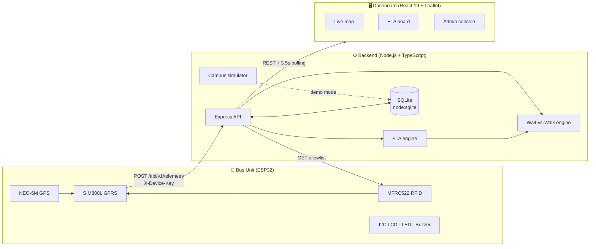

<div align="center">

# 🚌 RAAHI

### Real-time Arrival and Attendance Hub via IoT

**An end-to-end campus transit platform: custom ESP32 bus hardware, a Node.js telemetry & decision engine, and a live React dashboard, built for the Central University of Karnataka.**


</div>

---

## Table of Contents

- [Overview](#overview)
- [Features](#features)
- [System Architecture](#system-architecture)
- [Campus Configuration](#campus-configuration)
- [Tech Stack](#tech-stack)
- [Project Structure](#project-structure)
- [Getting Started](#getting-started)
- [Configuration](#configuration)
- [How It Works](#how-it-works)
- [API Reference](#api-reference)
- [Database Schema](#database-schema)
- [Hardware & IoT](#hardware--iot)
- [Testing](#testing)
- [Security Notes](#security-notes)
- [Known Limitations & Roadmap](#known-limitations--roadmap)
- [Author](#author)
- [License](#license)

---

## Overview

Campus shuttles used to be a guessing game. The Central University of Karnataka (CUK) in Kalaburagi spans a **654-acre** campus, and students had no way to know where a bus was, when it would arrive, or whether it was even worth waiting for.

**RAAHI** (*Real-time Arrival and Attendance Hub via IoT*) closes that loop with a complete hardware-to-cloud system rather than a standalone map or an isolated microcontroller prototype:

1. **A bus-mounted ESP32 unit** reads GPS position, taps students in with RFID, and reports over cellular GPRS.
2. **A TypeScript backend** ingests that telemetry, computes ETAs along the real campus road layout, and answers the question every student actually has: *should I wait for the bus, or just walk?*
3. **A web dashboard** shows live buses on a map, stop countdown boards, the timetable, passenger-flow analytics, and an admin console for fleet and RFID card management.

A built-in **campus simulator** drives four demo shuttles along the real CUK road geometry, so the entire platform can be developed, tested and demonstrated with no hardware attached.

<!--
  📸 Add screenshots here once you have them, e.g.:
  
  
-->

---

## Features

### For students

| | |
|---|---|
| 🗺️ **Live campus map** | Real-time bus markers with heading arrows and speed labels, drawn over the actual road paths for both routes. Filter by route, click a bus to focus it, click a stop to jump to its ETAs. |
| ⏱️ **Stop arrival countdowns** | Per-stop ETA board for every bus approaching, sorted by soonest arrival, with a confidence rating and a live/standby telemetry indicator. Refreshes every 3.5 s. |
| 🚶 **Wait vs. Walk advisor** | Compares *bus wait + ride + final walk* against *walking directly* and tells you which is faster, with a transparent time breakdown. |
| 📅 **Timetable** | Morning and afternoon operating windows, 15-minute departures, with the current slot highlighted and a live "active shift" indicator. |

### For operations

| | |
|---|---|
| 🛡️ **Admin console** | Session-authenticated dashboard with fleet overview, RFID allowlist management, a boarding audit trail, and simulator controls. |
| 💳 **RFID attendance** | Every card tap is recorded as an authorized boarding or a denied attempt. Card UIDs are masked in event logs and the audit trail. |
| 📊 **Passenger-flow analytics** | Boardings by hour of day, day of week, stop and bus over a rolling 28-day window, plus a Low / Moderate / High demand estimate per stop. |
| 🔄 **OTA card allowlist** | Bus units pull the authorized-card list from the server, versioned with a `syncVersion`, so card changes reach the hardware without reflashing. |

### Engineering

- **Stale-telemetry detection**: buses that stop reporting are flagged, and their ETAs are downgraded to low confidence.
- **Honest uncertainty**: every ETA carries a confidence level and a plain-language description of how it was computed. The advisor returns `INSUFFICIENT_DATA` rather than guessing.
- **Two telemetry payload formats**: a compact firmware format and an extended structured format, normalized on ingest.
- **Event de-duplication**: RFID events carry an ID so retried uploads over flaky cellular links don't double-count.
- **Demo data is always labelled**: everything produced by the simulator or seed script is flagged `is_demo = 1` and shown as "Simulator" in the UI.
- **49 automated tests** covering the ETA maths, the recommendation logic, coordinate validation, auth rules and the HTTP API.

---

## System Architecture



**Data flow:** the bus unit posts telemetry (position, speed, network state, optional RFID tap) → the API validates and stores it, updates the bus's live position → the ETA engine converts position into per-stop arrival times → the dashboard polls and renders. The Wait-vs-Walk engine reuses the ETA output and adds historical demand context.

---

## Campus Configuration

The platform ships pre-configured for the CUK Kalaburagi campus (Kadaganchi, Aland Taluk).

**Routes** (each runs the road path out to the Class Room Complex and loops back)

| Route | Color | Path |
|---|---|---|
| Boys Hostel Route | 🔵 `#1d4ed8` | Amarja Hostel → Central Library → CRC |
| Girls Hostel Route | 🟣 `#db2777` | Narmada Hostel → Central Library → CRC |

**Stops**

| ID | Name | Lat / Lng |
|---|---|---|
| `stop-amarja` | Amarja Hostel (Boys) | 17.439068, 76.674685 |
| `stop-narmada` | Narmada Hostel (Girls) | 17.424813, 76.672557 |
| `stop-library` | Central Library | 17.433527, 76.672281 |
| `stop-crc` | CRC (Class Room Complex) | 17.431569, 76.670906 |

**Fleet**: 4 shuttles, 2 per route

| Bus ID | Name | Route | Device ID |
|---|---|---|---|
| `bus-b1` | BH-01 (Boys Shuttle 1) | Boys | `bus-unit-b1` |
| `bus-b2` | BH-02 (Boys Shuttle 2) | Boys | `bus-unit-b2` |
| `bus-g1` | GH-01 (Girls Shuttle 1) | Girls | `bus-unit-g1` |
| `bus-g2` | GH-02 (Girls Shuttle 2) | Girls | `bus-unit-g2` |

**Operating windows**: Morning **09:00 – 10:30** and Afternoon **13:00 – 14:30**, departures every **15 minutes**.

The exact road waypoints for both routes live in `backend/src/engine/campusRoutes.ts` (used by the simulator) and `frontend/src/data/campusRoutes.ts` (used to draw the map). To adapt RAAHI to another campus, replace those two files and the seed data in `backend/src/db/seed.ts`.

---

## Tech Stack

| Layer | Technology |
|---|---|
| **Firmware / hardware** | ESP32, NEO-6M GPS, SIM800L GPRS modem, MFRC522 RFID reader, 16×2 I²C LCD |
| **Backend** | Node.js, TypeScript, Express 4, Node's built-in `node:sqlite`, `express-session`, Helmet, CORS, `express-rate-limit`, `dotenv`, `uuid` |
| **Frontend** | React 19, TypeScript, Vite, Leaflet, `lucide-react`, Oxlint |
| **Testing** | Vitest, Supertest |
| **Tooling** | `tsx` (dev runner), `tsc` (build) |

> The database uses Node's **native `node:sqlite`** module, so there is no native-addon compilation and no external database server to install.

---

## Project Structure

```
RAAHI/
├── backend/
│   ├── src/
│   │   ├── index.ts                 # Express app: security, sessions, rate limits, routes
│   │   ├── config.ts                # Environment-driven configuration
│   │   ├── db/
│   │   │   ├── database.ts          # node:sqlite connection (WAL) + schema
│   │   │   ├── seed.ts              # CUK campus seed data + 7 days of history
│   │   │   └── reset.ts             # Wipe & re-seed the database
│   │   ├── engine/
│   │   │   ├── eta.ts               # Haversine + route-distance ETA engine
│   │   │   ├── recommendation.ts    # Wait-vs-Walk + demand estimation
│   │   │   ├── simulator.ts         # Demo buses driving the real roads
│   │   │   └── campusRoutes.ts      # Road waypoints for both routes
│   │   ├── middleware/auth.ts       # Device-key auth, admin session guard, request log
│   │   ├── routes/
│   │   │   ├── public.ts            # Buses, routes, stops, ETA, recommendation, analytics
│   │   │   ├── device.ts            # Telemetry ingest + card allowlist sync
│   │   │   └── admin.ts             # Auth + CRUD + audit + simulator control
│   │   └── test/setup.ts            # Isolated test database lifecycle
│   ├── package.json
│   └── vitest.config.ts
│
├── frontend/
│   ├── src/
│   │   ├── App.tsx                  # Tab shell, polling, global state
│   │   ├── api.ts                   # Typed API client
│   │   ├── types.ts
│   │   ├── data/campusRoutes.ts     # Road geometry for map polylines
│   │   └── components/
│   │       ├── MapTracker.tsx           # Live Leaflet map + fleet sidebar
│   │       ├── StopEtaBoard.tsx         # Per-stop arrival countdowns
│   │       ├── ScheduleBoard.tsx        # Timetable + shift status
│   │       ├── RecommendationCalculator.tsx   # Wait vs Walk
│   │       ├── DemandAnalytics.tsx      # Passenger-flow charts
│   │       ├── HardwareGuide.tsx        # Pin map + telemetry playground
│   │       └── AdminDashboard.tsx       # Operations console
│   ├── vite.config.ts               # Dev server :5173, proxies /api → :3001
│   └── package.json
│
└── LINKEDIN_POST.md                 # Ready-to-publish project announcements
```

---

## Getting Started

### Prerequisites

- **Node.js 22.13 or newer.** RAAHI uses the built-in `node:sqlite` module, which is no longer flag-gated from 22.13 onwards. (Developed and tested on Node 22; Node prints an `ExperimentalWarning: SQLite is an experimental feature` message, which is expected.)
- **npm** (bundled with Node).

### 1. Clone

```bash
git clone <your-repo-url> raahi
cd raahi
```

### 2. Start the backend

```bash
cd backend
npm install
npm run dev
```

On first launch the backend creates `backend/data/smartbus.db`, seeds the CUK campus data, and (because demo mode is on by default) starts the simulator. You should see:

```
╔══════════════════════════════════════════════╗
║   Smart Bus Tracking System — Backend        ║
╠══════════════════════════════════════════════╣
║  Port:      3001                             ║
║  Demo:      true                             ║
║  Database:  ./data/smartbus.db               ║
╚══════════════════════════════════════════════╝
```

### 3. Start the frontend

In a second terminal:

```bash
cd frontend
npm install
npm run dev
```

Open **<http://localhost:5173>**. Four shuttles will already be circulating on the map.

The Vite dev server proxies `/api` to `http://localhost:3001`, so no CORS setup is needed during development.

### 4. Sign in to the admin console

Open the **Admin** tab and use the demo credentials:

| Username | Password |
|---|---|
| `admin` | `smartbus2026` |

> ⚠️ These are development defaults. **Change them before any real deployment**; see [Security Notes](#security-notes).

### Useful commands

| Where | Command | What it does |
|---|---|---|
| `backend/` | `npm run dev` | Run with hot reload (`tsx watch`) |
| `backend/` | `npm test` | Run the full test suite once |
| `backend/` | `npm run test:watch` | Tests in watch mode |
| `backend/` | `npm run db:reset` | Delete the database and re-seed (stop the server first) |
| `backend/` | `npm run build` | Compile TypeScript to `dist/` |
| `backend/` | `npm start` | Run the compiled build |
| `frontend/` | `npm run build` | Type-check and produce a production bundle in `dist/` |
| `frontend/` | `npm run lint` | Lint with Oxlint |
| `frontend/` | `npm run preview` | Serve the production build locally |

### Production build

```bash
# Backend
cd backend && npm run build
NODE_ENV=production DEMO_MODE=false npm start

# Frontend
cd frontend && npm run build   # static files in frontend/dist
```

The backend serves the API only. Host `frontend/dist` with any static file server or reverse proxy, and route `/api` to the backend. Session cookies are marked `secure` in production, so serve over HTTPS.

---

## Configuration

Configuration is read from environment variables, loaded from a **`.env` file in the project root** (the folder that contains `backend/` and `frontend/`). Every setting has a sensible development default, so a `.env` is optional locally.

| Variable | Default | Description |
|---|---|---|
| `PORT` | `3001` | Backend HTTP port |
| `NODE_ENV` | `development` | Set to `production` to enable secure cookies |
| `DB_PATH` | `./data/smartbus.db` | SQLite file path (relative to where the backend is launched) |
| `DEMO_MODE` | `true` | Run the simulator. Set to `false` to use real hardware only |
| `ADMIN_USERNAME` | `admin` | Admin login name |
| `ADMIN_PASSWORD` | `smartbus2026` | Admin login password |
| `SESSION_SECRET` | `change-this-to-a-random-string-in-production` | Secret used to sign session cookies |
| `DEVICE_API_KEYS` | `demo-device-key-001` | Comma-separated list of keys accepted from bus units |
| `CORS_ORIGIN` | `http://localhost:5173` | Allowed browser origin |
| `STALE_TIMEOUT_SEC` | `60` | Seconds without telemetry before a bus is considered stale |
| `DEFAULT_BUS_SPEED_KMPH` | `20` | Fallback speed used for ETAs when GPS speed is unavailable |

Example production `.env`:

```ini
NODE_ENV=production
PORT=3001
DEMO_MODE=false
ADMIN_USERNAME=ops
ADMIN_PASSWORD=use-a-long-random-passphrase
SESSION_SECRET=paste-output-of-openssl-rand-hex-32
DEVICE_API_KEYS=key-for-bus-1,key-for-bus-2,key-for-bus-3,key-for-bus-4
CORS_ORIGIN=https://raahi.example.edu
```

---

## How It Works

### ETA engine (`engine/eta.ts`)

For each bus and each stop on its route, RAAHI computes an arrival estimate in four steps:

1. **Validate.** Reject buses with no GPS fix or out-of-range coordinates (`confidence: unavailable`).
2. **Measure distance along the route, not as the crow flies.** It finds the stop nearest the bus, adds the bus-to-stop distance, then sums the **Haversine** distance of each subsequent stop-to-stop segment up to the target. If the bus has already passed the target, it continues forward around the loop (last stop → first stop → target).
3. **Pick a speed.** Live GPS speed is used when it is between 1 and 120 km/h; otherwise it falls back to `DEFAULT_BUS_SPEED_KMPH` (20 km/h).
4. **Convert to time and grade confidence.**

| Confidence | When |
|---|---|
| `high` | Fresh telemetry using live GPS speed |
| `medium` | Fresh telemetry, but using the fallback speed |
| `low` | Telemetry older than `STALE_TIMEOUT_SEC` |
| `unavailable` | No GPS fix or invalid coordinates |

Every result also includes a human-readable `method` string (for example, *"Route distance with gps_speed at 22 km/h"*) so the number is never a black box.

### Wait-vs-Walk advisor (`engine/recommendation.ts`)

```
walking total = walking time from the student's position to their destination
bus total     = wait for bus at pickup  +  ride to destination stop  +  final walk
```

The two are compared and one of four outcomes is returned:

| Outcome | Meaning |
|---|---|
| `WAIT_FOR_BUS` | The bus gets you there more than 2 minutes sooner |
| `WALK` | Walking is more than 2 minutes faster |
| `EITHER_SIMILAR` | Within 2 minutes either way |
| `INSUFFICIENT_DATA` | No usable bus ETA or journey time |

The response includes the full breakdown (wait / ride / final walk), the time difference, a plain-English explanation, and any data limitations. It only considers buses on a route that serves **both** the pickup and destination stops.

### Demand estimation

RFID boardings act as a proxy for demand at a stop. The estimator degrades gracefully through three levels:

1. **Same weekday + same hour**, last 28 days (needs ≥ 2 matching days; high confidence from 3).
2. **Same hour, any weekday** (low confidence).
3. **Otherwise**: `insufficient_data`, with an explanation of why.

Average boardings per matching day map to **low** (< 3), **moderate** (3–5.9) and **high** (≥ 6).

### Telemetry ingest (`routes/device.ts`)

- Authenticates the `X-Device-Key` header.
- Accepts either payload format (see [API Reference](#api-reference)) and normalizes it.
- Validates coordinates when a GPS fix is claimed, rejects malformed timestamps and timestamps more than a day in the future.
- Updates the bus's live position, appends to the telemetry history, and records any RFID event (de-duplicated by event ID, with the card UID masked before it is written to the audit log).
- If a bus loses its GPS fix, its last known position is retained and only its network state and heartbeat are updated.

### Campus simulator (`engine/simulator.ts`)

In demo mode, a 2.5-second tick advances each bus one waypoint along the real CUK road geometry (forward to the CRC and back again), writing position, speed (18 or 22 km/h), heading, and telemetry history. The second bus on each route starts half a loop ahead so the pair is staggered. Occasional demo boarding events are generated deterministically. The simulator can be started and stopped from the Admin console.

---

## API Reference

Base URL: `http://localhost:3001/api`. All responses are JSON.

### Public

| Method | Endpoint | Description |
|---|---|---|
| `GET` | `/health` | Status, timestamp, demo-mode flag, version |
| `GET` | `/v1/buses` | All enabled buses with `isOnline` / `isStale` |
| `GET` | `/v1/buses/:busId` | One bus |
| `GET` | `/v1/routes` | Active routes with their ordered stops |
| `GET` | `/v1/stops` | All stops |
| `GET` | `/v1/stops/:stopId/eta` | ETAs of every bus heading to the stop, soonest first |
| `GET` | `/v1/recommendation` | Wait-vs-Walk. Query: `pickupStopId`, `destinationStopId`, `walkingMin` (required), `finalWalkMin` (optional) |
| `GET` | `/v1/analytics/demand` | Hourly/daily/per-stop boardings. Optional `stopId` adds a current-demand estimate |

```bash
curl "http://localhost:3001/api/v1/recommendation?pickupStopId=stop-amarja&destinationStopId=stop-crc&walkingMin=19&finalWalkMin=2"
```

### Device (header `X-Device-Key: <key>`)

| Method | Endpoint | Description |
|---|---|---|
| `POST` | `/v1/telemetry` | Ingest a position update and/or RFID event |
| `GET` | `/v1/devices/:deviceId/allowlist` | Authorized-card list with `syncVersion` for OTA sync |

**Firmware format** (compact, what the ESP32 sends):

```json
{
  "bus_id": "bus-b1",
  "event": "boarding",
  "card_uid": "01:02:03:04",
  "gps_fix": true,
  "latitude": 17.439068,
  "longitude": 76.674685,
  "uptime_ms": 1000
}
```

`event` is one of `periodic_location`, `boarding`, `unauthorized_card`, `sync_button`. A card UID is recorded only for `boarding` and `unauthorized_card`.

**Extended format** (structured; supports speed, heading and network state):

```json
{
  "deviceId": "bus-unit-b1",
  "busId": "bus-b1",
  "timestamp": "2026-10-24T09:30:00.000Z",
  "gps": { "fix": true, "latitude": 17.4332, "longitude": 76.6724, "speedKmph": 18, "heading": 195 },
  "network": { "registered": true, "dataConnected": true },
  "rfidEvent": {
    "eventId": "7c1f…",
    "cardToken": "01:02:03:04",
    "eventType": "BOARDING",
    "authorized": true,
    "timestamp": "2026-10-24T09:30:00.000Z"
  }
}
```

> The compact firmware format carries no speed, so ETAs for a bus using it fall back to the default speed (`medium` confidence). Send the extended format to get GPS-speed-based `high` confidence ETAs.

```bash
curl -X POST http://localhost:3001/api/v1/telemetry \
  -H "X-Device-Key: demo-device-key-001" \
  -H "Content-Type: application/json" \
  -d '{"bus_id":"bus-b1","event":"boarding","card_uid":"01:02:03:04","gps_fix":true,"latitude":17.439068,"longitude":76.674685}'
```

| Status | Meaning |
|---|---|
| `200` | Accepted |
| `400` | Missing `bus_id`, invalid coordinates with a GPS fix, or bad timestamp |
| `401` / `403` | Missing / invalid device key |
| `404` | Unknown bus ID (in `NODE_ENV=development`, unknown buses are auto-registered instead) |

### Admin (session cookie)

| Method | Endpoint | Description |
|---|---|---|
| `POST` | `/v1/admin/login` · `/logout` | Start / end an admin session |
| `GET` | `/v1/admin/session` | Check whether the current session is an admin |
| `GET` | `/v1/admin/overview` | Fleet counts, today's boardings/denials, recent events and telemetry |
| `GET` `POST` `PUT` `DELETE` | `/v1/admin/buses[/:id]` | Manage buses |
| `GET` `POST` `PUT` `DELETE` | `/v1/admin/routes[/:id]` | Manage routes and their ordered stops |
| `GET` `POST` `PUT` `DELETE` | `/v1/admin/stops[/:id]` | Manage stops |
| `GET` `POST` `PUT` `DELETE` | `/v1/admin/cards[/:id]` | Manage the RFID allowlist (each change bumps the sync version) |
| `GET` | `/v1/admin/events` | Boarding audit trail. Filters: `busId`, `eventType`, `authorized`, `limit`, `offset` |
| `GET` `POST` | `/v1/admin/crowd-observations` | Manual crowd counts per stop |
| `GET` | `/v1/admin/analytics` | Boardings by hour, weekday, stop and bus |
| `POST` | `/v1/admin/simulator/start` · `/stop` | Control the simulator |
| `GET` | `/v1/admin/simulator/status` | Whether the simulator is running |

**Rate limits:** 1,000 requests / 15 min across `/api`, and 20 / 15 min on admin login.

---

## Database Schema

SQLite in WAL mode with foreign keys enforced. The schema is created automatically on startup.

| Table | Purpose |
|---|---|
| `routes` | Route name, description, color, active flag |
| `stops` | Stop name, coordinates, description |
| `route_stops` | Ordered stop assignments per route (unique per route and order) |
| `buses` | Fleet, plus each bus's live position, speed, heading, GPS and network state, last-seen time |
| `devices` | Registered hardware units linked to buses |
| `telemetry` | Position/heartbeat history (`is_demo` flag separates simulated data) |
| `authorized_cards` | RFID allowlist with `sync_version` |
| `rfid_events` | Boarding audit trail with masked card token, authorization result, stop and location |
| `crowd_observations` | Manually recorded crowd counts per stop |
| `app_config` | Key/value metadata (campus and platform name) |

---

## Hardware & IoT

Each bus carries an **ESP32 unit** that combines three jobs: *where am I* (GPS), *who boarded* (RFID), and *tell the server* (cellular). A 16×2 LCD, status LED and buzzer give the driver and student instant audio-visual feedback on every tap.

### Components

| Component | Role |
|---|---|
| **ESP32** | Main controller |
| **NEO-6M** | GPS positioning |
| **SIM800L** | GPRS cellular telemetry |
| **MFRC522** | Contactless RFID boarding pass |
| **16×2 I²C LCD** (0x27) | On-board status display |
| **LED + buzzer** | Tap feedback |
| **Push button** | Manual allowlist sync |

### ESP32 pin map

| Peripheral | Signal | ESP32 pin | Interface |
|---|---|---|---|
| MFRC522 | SS / SDA | GPIO 5 | 3.3 V SPI |
| MFRC522 | SCK | GPIO 18 | 3.3 V SPI |
| MFRC522 | MOSI / MISO | GPIO 23 / 19 | 3.3 V SPI |
| MFRC522 | RST | GPIO 4 | Digital out |
| NEO-6M GPS | TX → ESP32 RX | GPIO 16 | UART2, 9600 baud |
| NEO-6M GPS | RX ← ESP32 TX | GPIO 17 | UART2 |
| SIM800L | TX → ESP32 RX | GPIO 26 | UART1, 9600 baud |
| SIM800L | RX ← ESP32 TX | GPIO 27 | UART1 |
| 16×2 LCD | SDA / SCL | GPIO 21 / 22 | I²C (0x27) |
| Status LED | Anode (+220 Ω) | GPIO 14 | Digital out |
| Buzzer | Positive lead | GPIO 25 | PWM tone |
| Sync button | Switch to GND | GPIO 32 | `INPUT_PULLUP` |

### Electrical design notes

- **SIM800L power (the one that bites everyone).** The GSM modem draws **2.0 A transient bursts** during RF transmission. Never power it from the ESP32's 3.3 V or 5 V pin. Use a dedicated step-down converter (3.8–4.2 V) or an 18650 Li-ion cell, with a **1000 µF low-ESR capacitor** directly across the modem's VCC and GND to ride through the surges and prevent brownout resets.
- **GPS cold start.** Allow **30–45 seconds** outdoors for the first satellite fix. The firmware checks the NMEA `$GPRMC` validity flag before reporting a position as valid, and the backend treats `gps_fix: false` as "no position" rather than trusting stale coordinates.
- **I²C level shifting.** If the LCD backpack's pull-ups are tied to 5 V, use a bidirectional 4-channel logic-level shifter so GPIO 21 / 22 never exceed 3.3 V.
- **Enclosure.** A snap-fit vehicle enclosure was designed in **OpenSCAD**, with dedicated thermal and RF-isolation chambers for the high-burst GSM radio.

### Hardware playground

The dashboard's **Hardware & IoT** tab includes a *Device Telemetry Playground*: pick a bus, an event type and coordinates, and fire a real `POST /api/v1/telemetry` from the browser (and query the card allowlist) to test ingestion end to end before the physical unit is ready.

---

## Testing

```bash
cd backend
npm test
```

**49 tests, all passing**, run against an isolated, auto-deleted test database:

| Suite | Tests | Covers |
|---|---|---|
| `engine/eta.test.ts` | 21 | Haversine accuracy, nearest-stop search, route-distance summation, coordinate validation, speed selection and fallback, stale detection, ETA generation (no fix / invalid coordinates / stale / empty route) |
| `engine/recommendation.test.ts` | 7 | Bus-faster, walk-faster and similar outcomes, insufficient data, final-walk inclusion, transparent breakdown |
| `routes/api.test.ts` | 21 | Telemetry auth and validation (both payload formats, boarding events, GPS-unavailable), admin login rules, allowlist access control, every public endpoint |

---

## Security Notes

RAAHI includes sensible baseline protections, and the defaults are for **development only**.

**Already in place:** Helmet security headers, CORS restricted to a configured origin, HTTP-only / `SameSite=Lax` session cookies (24 h, `secure` in production), rate limiting (stricter on login), a 1 MB request-body limit, parameterized SQL throughout, API-key authentication for devices, and masking of RFID card UIDs in all event logs and the boarding audit trail.

**Before deploying for real users:**

- [ ] Set a strong `ADMIN_PASSWORD` and a random `SESSION_SECRET` (`openssl rand -hex 32`)
- [ ] Replace `demo-device-key-001` with unique, unguessable `DEVICE_API_KEYS`
- [ ] Set `NODE_ENV=production` and serve over HTTPS
- [ ] Set `CORS_ORIGIN` to your real frontend origin
- [ ] Set `DEMO_MODE=false` so simulated buses don't mix with real ones

---

## Known Limitations & Roadmap

RAAHI is a working campus prototype. These are the honest edges:

- **ETA model is geometric.** Distance is summed stop-to-stop using Haversine and a nearest-stop heuristic; it is not yet map-matched to the road polyline, and historical travel times are not yet fed back in. With only three stops per route, accuracy is intentionally coarse.
- **Authentication is deliberately simple.** Devices share the keys in `DEVICE_API_KEYS` (the per-device `api_key` column is not yet enforced), there is a single admin account sourced from the environment, and sessions use Express's in-memory store.
- **Telemetry grows unbounded.** There is no retention/pruning job yet.
- **Demo analytics are simulated.** In demo mode, the passenger-flow charts are built from seeded and simulated boardings, not real riders.
- **Map tiles.** The map currently loads Google Maps raster tiles via a public tile URL. Before any public deployment, switch to a provider with terms that permit it (OpenStreetMap-based tiles, Mapbox, or the official Google Maps Platform).
- **Frontend hosting.** The backend serves the API only; the built frontend must be hosted separately.
- **Card tokens at rest.** Card UIDs are stored in clear text in `authorized_cards` (the bus units need them to sync) and shown in full on the admin allowlist screen; they are masked only in event logs and the audit trail. Consider hashing or encryption if the threat model requires it.

**Ideas for next steps:** map-matched ETAs, learning per-segment travel times from telemetry history, per-device credentials, retention policies, push notifications for an approaching bus, and a driver-facing display.

---

## Author

**Anant Bhardwaj**, built for the Central University of Karnataka, Kalaburagi.

Campus links used in the app: [CUK Campus](https://maps.app.goo.gl/4GdfTr5JbjiLWJfp8) · [Amarja Hostel](https://maps.app.goo.gl/6PxbHHpPyDdk5YDz5) · [Narmada Hostel](https://maps.app.goo.gl/4S7URuMNWGWv8SoF7) · [CRC Complex](https://maps.app.goo.gl/ASMiLtxzsWiRYb36A)

---

## License

<!-- Choose a license and add a LICENSE file, e.g. MIT: https://choosealicense.com/licenses/mit/ -->
_License to be added._
